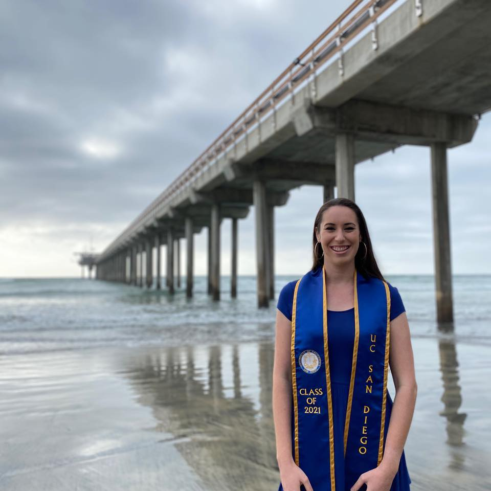
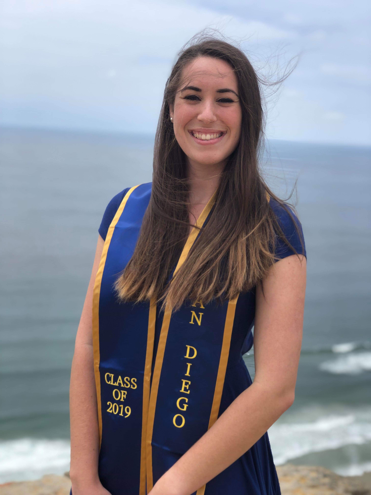

## [Cornell University](https://www.cornell.edu/)

Ithaca, NY

### Ph.D. Student in Computational Biology

Aug 2024 – Present

- Advisors: Erik Enbody and Philipp Messer
- Focused on empirical evolutionary biology, population genetics, and bioinformatics
- Integrating fieldwork and computational approaches to monitor hybridization in Darwin's finches (*Geospiza*) over time
- Investigating the fate of a rare hybrid lineage on Daphne Major (Galapagos Islands, Ecuador)
- Developed a genomic imputation pipeline in Snakemake for low-coverage whole-genome sequencing data

### Graduate Coursework

- Population Genetics
- Dynamic Models and Data in Biology
- Human Genomics

### Awards and Travel Grants

- 2026 Cornell Conference Grant ($500)

### Professional Affiliations

- Genetics Society of America (GSA)
- Society for the Study of Evolution (SSE)
- Computational Biology Graduate Student Association (CBGSA), President (2025–2026)

### Undergraduate Mentees

- Sasha Nathani-Sim (2026–present)
- Asa Elliott (2026–present)

---

## [UC San Diego](https://ucsd.edu/)

La Jolla, CA

### M.S. in Biology, Dept of Ecology, Behavior, and Evolution

Sept 2019 – June 2021

- Advisor: Scott Rifkin
- Developed an extensive, original agent-based model in Python to simulate the life cycles and interactions of a nematode population
- Designed and conducted laboratory experiments to study the effect of larval dietary restriction on developmental transitions
- Thesis: *Simulating the Evolutionary Effects of Environmental and Genetic Variation on Life History in Caenorhabditis* (Python)
- Co-authored two publications predicting the movements of *C. elegans* using empirical dynamic modeling (R)
- Good Academic Standing, 4.00 GPA

### Graduate Coursework

- Q-Biology
- Quantitative Ecology Project Lab
- Quantitative Evolutionary Biology
- Quantitative Theory of Populations and Communities

---

## [UC San Diego](https://ucsd.edu/)

La Jolla, CA

### B.S. in General Biology, Minor in Mathematics

Sept 2015 – June 2019

- Attended Eleanor Roosevelt College (ERC) in UCSD's unique college system
- Good Academic Standing, 3.68 GPA

### Biology Courses

- Evolution of Infectious Diseases
- Bioinformatics Laboratory
- Marine Biology
- Recombinant DNA Techniques
- Metabolic Biochemistry
- Evolution
- Ecology / Organisms and Habitats
- Human Physiology I
- Biostatistics
- Genetics
- Biology Lab

### Math Courses

- Applicable Math and Computing: Topics in Data Science
- History of Mathematics
- Mathematical Reasoning
- Applied Linear Algebra
- Vector Calculus
- Linear Algebra
- Differential Equations
- Calculus and Analytical Geometry
- Calculus / Science and Engineering

### Other STEM Courses

- Our Energy Future
- Organic Chemistry I and II
- Waves, Optics, and Modern Physics and Lab
- Electricity and Magnetism and Lab
- Mechanics and Lab
- General Chemistry I, II, III, and Lab

---

## [Folsom High School](https://www.fcusd.org/fhs)

Folsom, CA Aug 2011 – May 2015

- AP Coursework: Calculus, Biology, French, Psychology
- Honors Coursework: Chemistry, Physics, English
- Club Involvement: California Scholarship Federation, National Society of High School Scholars, Key Club, Interact Club
- Valedictorian and graduation speaker, 4.17 GPA

### Extracurricular Employment During High School

- Private Math Tutor (2012–2015): Assisted students with homework and test preparation in Geometry and Algebra 2
- Hebrew School Teacher, Temple Kol Shalom, El Dorado Hills CA (2010–2014): Taught Hebrew prayers and Jewish culture; guided students in Bar/Bat Mitzvah preparation
