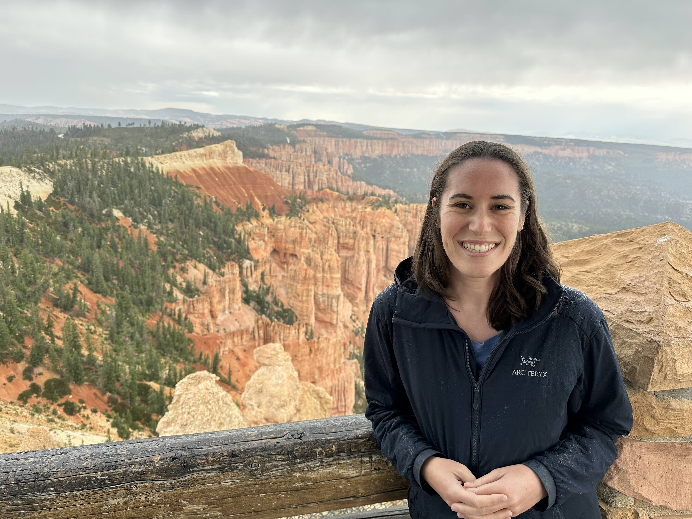

## Summary

Early-stage Ph.D. student in Computational Biology at Cornell University, with interdisciplinary training in evolutionary biology, population genetics, bioinformatics, and modeling. My research centers on understanding evolutionary processes, particularly hybridization dynamics, through genomic and computational approaches, using Darwin's finches as a model system. I earned both a B.S. and M.S. in Biology from UC San Diego, and subsequently spent three years as a research scientist at Illumina contributing to next-generation sequencing technology development. I am passionate about bridging fieldwork, wet lab science, and computational analysis to ask fundamental questions in evolutionary biology.

## Contact

<ul class="contact-list">
  <li><a href="https://www.linkedin.com/in/rachel-goodridge/">LinkedIn</a></li>
  <li><a href="https://github.com/RachelGoodridge">GitHub</a></li>
  <li><a href="mailto:reg259@cornell.edu">reg259@cornell.edu</a></li>
</ul>
